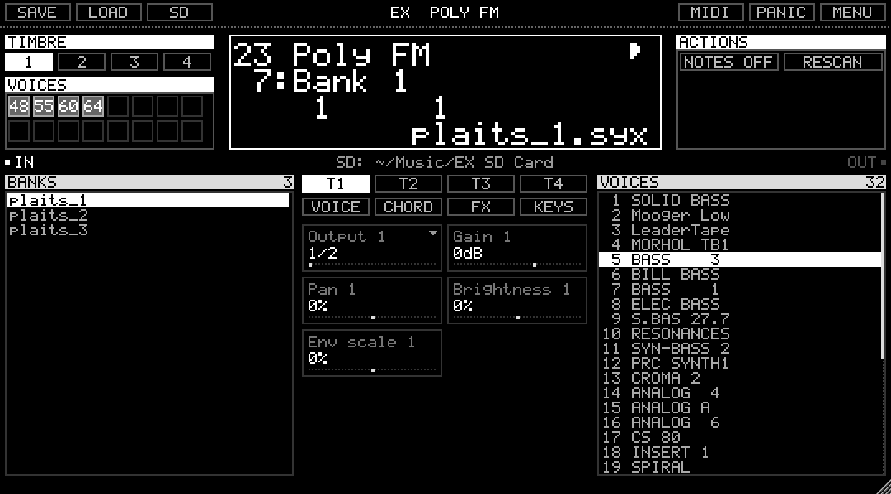
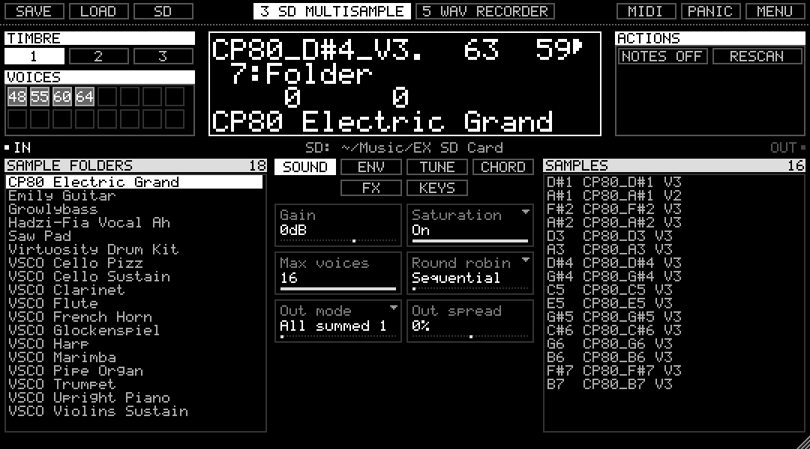
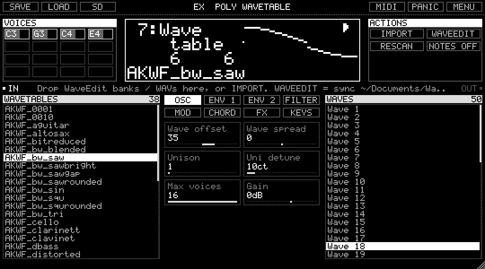
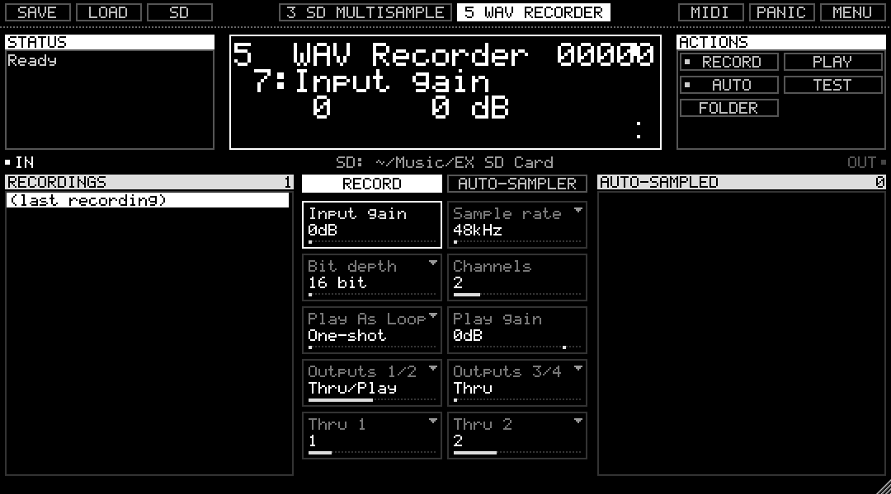
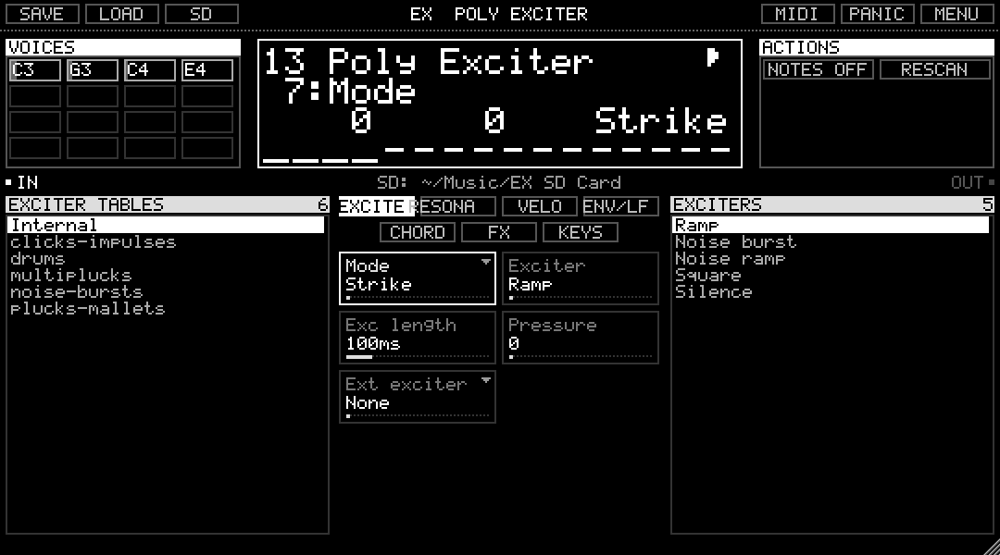

# EX-GF

Four instruments modelled on algorithms of the Expert Sleepers **disting EX** Eurorack module. Each one comes as a **VST3**, an **AU** (macOS), an **LV2** (Linux) and a **standalone app**, for **macOS, Windows and Linux**:

| Plug-in | What it is |
|---|---|
| **EX Multisample** | *SD Multisample*: a 16-voice, 3-timbre sample player. It uses disting-format sample folders with velocity layers, round robins, loops, a chord generator, an arpeggiator, broken chords, EQ and delay. It also includes *WAV Recorder* with the **auto-sampler**, which plays any MIDI or CV instrument, records each note and writes a ready-to-play multisample folder. |
| **EX Poly Wavetable** | A 16-voice wavetable synth with two envelopes, a filter, an LFO, unison, a Juno-style chorus and delay. It **imports WaveEdit banks**. |
| **EX Poly FM** | A 16-voice, 4-timbre 6-operator FM synth built on the Plaits engine. It loads DX7 `.syx` banks and works with DX7 editors (e.g. Dexed) over SysEx. |
| **EX Poly Exciter** | A 16-voice exciter/resonator synth with built-in exciters, exciters from the SD card or live input, and Strike, Scrape and Strum modes. |

The plug-ins use the same sample, wavetable, exciter and bank formats as the module. You can point them at a real disting EX MicroSD card, and anything they create (auto-sampled folders, imported wavetables) works on the module.

> Not affiliated with or endorsed by Expert Sleepers. "disting" is their trademark and is used here only to describe compatibility.



<p>
 
 
</p>

The whole interface is drawn as one white-on-black pixel display in the module's own 5×7 font. Most settings are on screen:
- **Top row:** the module's 128×32 screen in the centre, with timbre/voices on the left and the action buttons on the right.
- **Lower row:** two mirrored browsers (for example banks | voices, folders | samples) with the parameter pages between them.
- **Status line:** hover over anything to see what it does.

## Install

Releases: **https://github.com/femifleming/ex-gf/releases**

### macOS - Homebrew
```sh
brew tap femifleming/ex-gf https://github.com/femifleming/ex-gf
brew trust femifleming/ex-gf         # Homebrew 7+ asks you to trust third-party taps
brew install --cask ex-gf            # apps + VST3 + AU
brew install --cask ex-gf-sd-card    # optional: the free sample library -> ~/Music/EX SD Card
```
The builds aren't notarised. If your DAW won't load the plug-ins, clear the download flag with:
`xattr -dr com.apple.quarantine ~/Library/Audio/Plug-Ins/VST3/EX*.vst3 ~/Library/Audio/Plug-Ins/Components/EX*.component`

### macOS / Linux - Homebrew from source
```sh
brew tap femifleming/ex-gf https://github.com/femifleming/ex-gf
brew trust femifleming/ex-gf
brew install ex-gf                   # builds from source; `brew info ex-gf` shows where the plug-ins went
```

### macOS (download)
Download `EX-GF-<version>-macOS.zip`, unzip it and double-click **install.command**. Or run `EX-GF-<version>-macOS.pkg`, then right-click → Open, because the builds aren't notarised.

### Windows
Download `EX-GF-<version>-Windows-x64.zip`, unzip it, right-click **install.ps1** → *Run with PowerShell* (as administrator). VST3 plug-ins go to `C:\Program Files\Common Files\VST3`, and the apps go in the Start menu under **EX-GF**.

### Linux
```sh
tar xzf EX-GF-<version>-Linux-x86_64.tar.gz && cd ex-gf-*-Linux-* && ./install.sh
```
This puts VST3 in `~/.vst3`, LV2 in `~/.lv2` and the apps in `~/.local/bin`, with menu entries.

### Sample library (all platforms)
Download **EX-SD-Card.zip** from the release and unzip it into your Music folder, so you get `Music/EX SD Card`. Or choose any folder with the **SD** button. It contains 18 multisampled instruments, 38 wavetables, 5 exciter tables, DX7 banks and tuning files, all free (CC0 / CC-BY / MIT). See `CREDITS.txt` inside for sources and licences.

## Using it
📖 **[PDF manual](docs/EX-GF-manual.pdf)** (also attached to each release). The same material is in **[docs/INSTRUCTIONS.md](docs/INSTRUCTIONS.md)** for the full guide. The short version:
- **Lists:** click a folder, wavetable, bank or voice to load it.
- **Parameter tiles:** drag up/down or use the mouse wheel. Hold shift for fine steps, double-click to reset. Tiles with a ▾ open a list of choices.
- **Display:** the wheel moves through parameters and shift+wheel changes the value. ↑↓ / ←→ / Enter / Esc work like the module's P and V encoders.
- **SAVE / LOAD:** presets stored on the SD card. Each plug-in also **remembers its last state** automatically, both in the app and in new plug-in instances.
- **Playing:** MIDI, or the computer keyboard with **A W S E D F T G Y H U J K** (**Z/X** change octave).

## Build from source
```sh
git clone --recursive https://github.com/femifleming/ex-gf && cd ex-gf
cmake -B build -DCMAKE_BUILD_TYPE=Release        # add -G Ninja if you have it
cmake --build build --config Release
build/EXTest_artefacts/Release/EXTest out          # offline tests
build/EXTest_artefacts/Release/EXTest --host build/*_artefacts/Release/VST3/*.vst3   # load the plug-ins like a DAW
```
Options: `-DEX_COPY_AFTER_BUILD=ON` installs into your plug-in folders, and `-DEX_BUILD_TESTS=OFF` skips the test tool.
Manual: `EXTest --dump-params params.json && python3 tools/make_manual.py params.json docs/EX-GF-manual.pdf` (needs `pip install reportlab pillow`).
Release packages: `packaging/package-macos.sh`, `packaging/package-linux.sh`, `packaging/package-windows.ps1`.
On Linux you need: `libasound2-dev libjack-jackd2-dev libfreetype6-dev libfontconfig1-dev libx11-dev libxcomposite-dev libxcursor-dev libxext-dev libxinerama-dev libxrandr-dev libxrender-dev libxi-dev libgl1-mesa-dev`.

Every push runs CI on macOS, Windows and Linux. It builds the plug-ins, runs the tests, loads every plug-in in a test host, and publishes release packages for tags.

## Human contributions

EX-GF's code was written with Claude Code (Anthropic), working under the direction of its author, [femifleming](https://github.com/femifleming). This is what the author brought to it:

- **Concept and scope.** The author chose the Expert Sleepers disting EX as the model: a plug-in and desktop app that work like its SD Multisample mode and read its multisample file format. They also asked for its Poly Wavetable, Poly FM and Poly Exciter algorithms as matching instruments, all in the same style.
- **WAV Recorder mode.** The workflow that sends MIDI out and records audio in to build new multisample sets.
- **Reference material.** The author supplied the disting EX user manual as the reference for how the modes behave and how the display looks.
- **Free sample library.** The author asked for free multisample libraries to be found and bundled.
- **Visual direction.** The pixel aesthetic of the disting EX display, applied to the whole plug-in rather than a single panel, and made easy to use rather than a literal copy.
- **Layout choice.** The author asked to see options, then picked the "split browser" layout from four mock-ups.
- **WaveEdit import.** Poly Wavetable loads the author's own wavetables made in the WaveEdit app.
- **Testing.** The author asked for all four instruments to be tested and to remember their last state.
- **Platforms and distribution.** Builds for macOS, Windows and Linux, packaged with a README and instructions as one bundle in a public GitHub repo, with a Homebrew install.
- **The name.** The author named the suite "EX-GF" (it was "EX Suite" before).

## Credits & licence
- The code is licensed **AGPL-3.0** (see `LICENSE`), as required for software built with [JUCE](https://juce.com) 9 under its open-source licence.
- The Poly FM engine is from [Mutable Instruments Plaits](https://github.com/pichenettes/eurorack) by Émilie Gillet (MIT; subset in `third_party/mi`).
- Algorithm behaviour follows the disting EX user manual by Expert Sleepers.
- The sample library is built from free sources listed in `CREDITS.txt`: VSCO-2 CE, Karoryfer, AKWF and more. The scripts that rebuild it are in `tools/library`.
